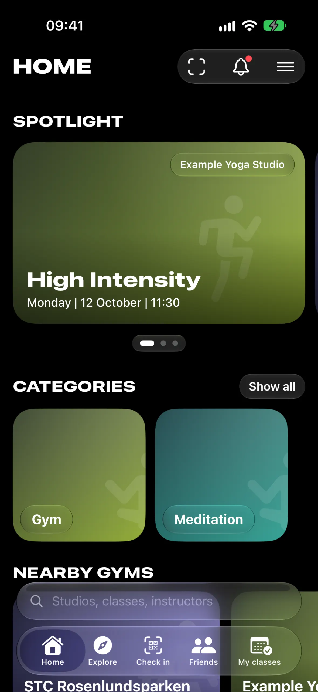
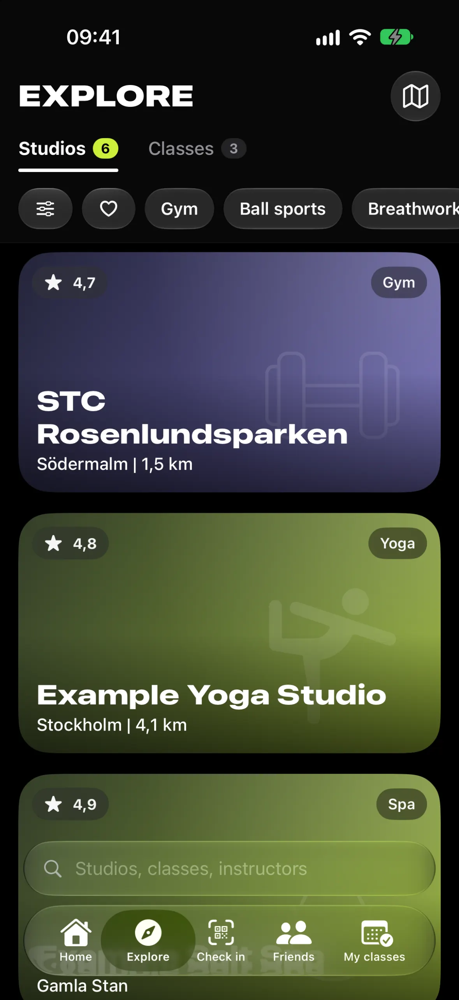
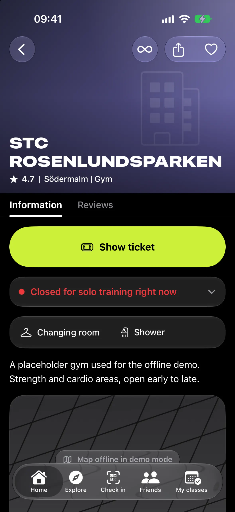
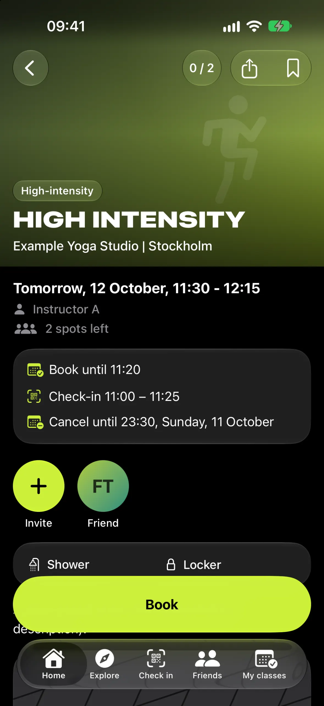
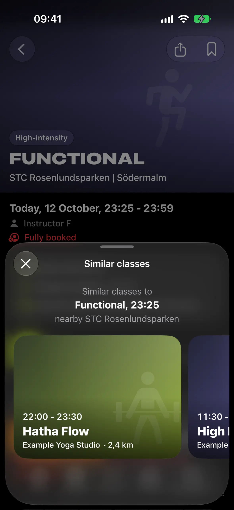
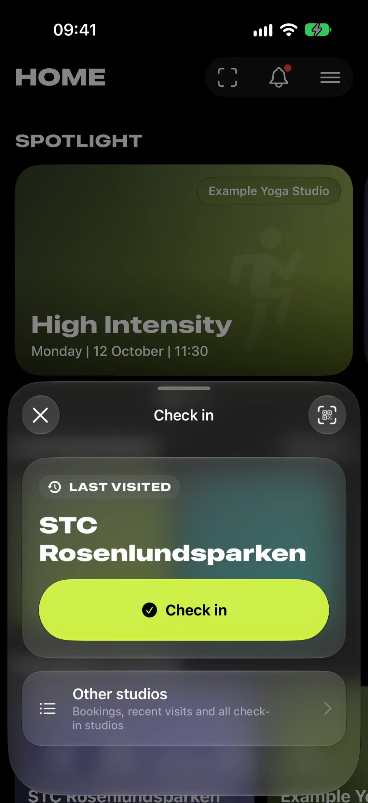
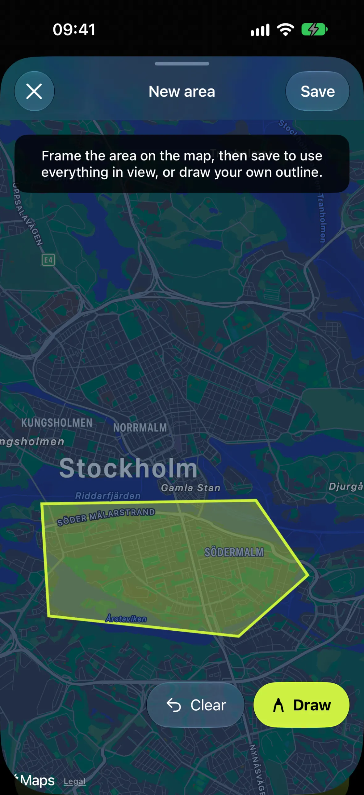
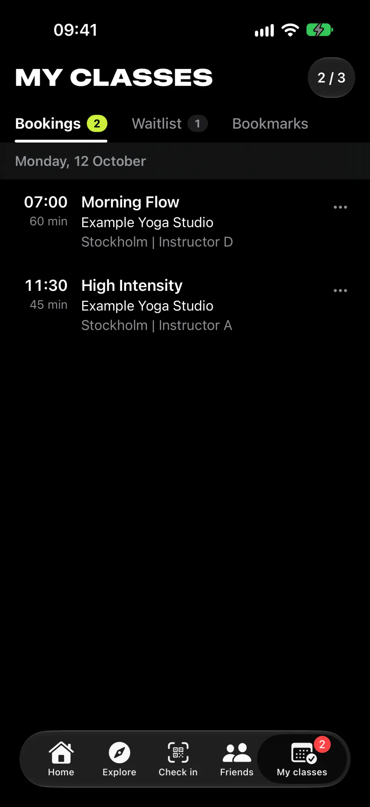
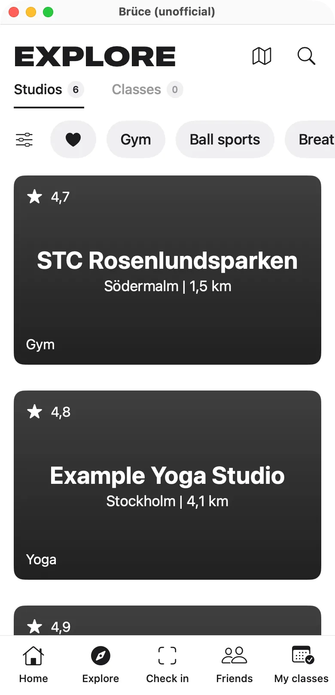
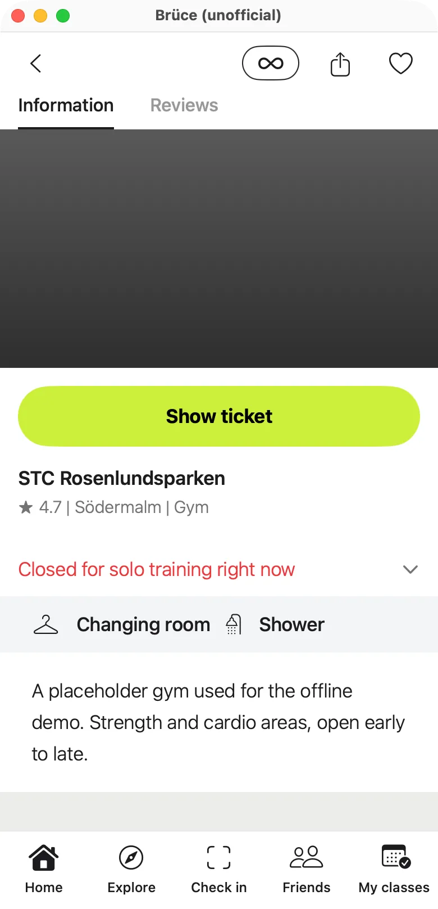

# Bruce: unofficial macOS and iOS clients for Bruce Studios

Native SwiftUI clients for the [Bruce Studios](https://www.brucestudios.com) fitness membership (Sweden, Norway,
Denmark), plus a reverse-engineered map of the app's v52 HTTP API.

**Project page: [djui.github.io/bruce](https://djui.github.io/bruce/)** · [Web app](https://djui.github.io/bruce/app/) · [API viewer](https://djui.github.io/bruce/api/)

> [!IMPORTANT]
> **Unofficial: not affiliated with or endorsed by Bruce Studios AB.** "Bruce Studios" and "Bruce" are
> trademarks of Bruce Studios AB. This is a personal hobby project. It is not the Bruce Studios app, is not
> supported by Bruce Studios, and may stop working whenever their API changes. You need your own Bruce
> Studios membership to use it.

## Screenshots

Captured in [demo mode](#demo-mode-developer-switch) with fictional data. They follow your light or
dark setting on GitHub; every screen is in [`docs/screenshots/`](docs/screenshots) in both appearances.

<p align="center">
<picture><source media="(prefers-color-scheme: light)" srcset="docs/screenshots/iphone-home-light.webp"></picture>
<picture><source media="(prefers-color-scheme: light)" srcset="docs/screenshots/iphone-explore-light.webp"></picture>
<picture><source media="(prefers-color-scheme: light)" srcset="docs/screenshots/iphone-studio-light.webp"></picture>
<picture><source media="(prefers-color-scheme: light)" srcset="docs/screenshots/iphone-detail-light.webp"></picture>
<picture><source media="(prefers-color-scheme: light)" srcset="docs/screenshots/iphone-similar-light.webp"></picture>
<picture><source media="(prefers-color-scheme: light)" srcset="docs/screenshots/iphone-quickcheckin-light.webp"></picture>
<picture><source media="(prefers-color-scheme: light)" srcset="docs/screenshots/iphone-drawarea-light.webp"></picture>
<picture><source media="(prefers-color-scheme: light)" srcset="docs/screenshots/iphone-mybookings-light.webp"></picture>
</p>

<p align="center">


</p>

## What's in here

| | |
|---|---|
| **Brüce for iPhone** ([`Bruce-iOS/`](Bruce-iOS/README.md)) | iOS 26+ app built with Liquid Glass throughout |
| **BruceMacOS** ([`Bruce-MacOS/`](Bruce-MacOS/README.md)) | Phone-sized SwiftUI app for macOS 14+, run with `swift run` |
| **Brüce Web** ([`docs/app/`](docs/app), [live](https://djui.github.io/bruce/app/)) | Browser version on GitHub Pages: plain HTML, CSS and JavaScript, no build step |
| **BruceCore** ([`Shared/BruceCore/`](Shared/BruceCore)) | Code shared by both apps: API client, models, Keychain session, app state, booking rules, demo data |
| **Auto-book server** ([`server/`](server/README.md)) | Cloudflare Worker that books users' weekly classes the moment they open and sends the result by push and email |
| **API map** ([`API.md`](API.md), [`openapi.yaml`](openapi.yaml), [`swagger.html`](swagger.html)) | The Bruce Studios v52 API as observed from the official iOS app 14.4.2 |

## Features

Both apps follow the structure of the official app screen by screen: Home, Explore, Check in, Friends and
My classes tabs, with class and studio pages and account sheets.

- **Log in** with your Bruce Studios email and password. Only the session tokens are kept, in the Keychain.
  As in the official app there is no token refresh: the server keeps accepting the access token after its
  nominal 3-hour expiry, so you are only asked to log in again when the server rejects it (HTTP 401).
- **Explore** all live studios (about 700 in Sweden) and the city-wide class schedule, with category,
  tier, Wellness and favourite filters, search, a map, and **custom areas**: draw an outline on the map and
  filter studios and classes to it. Long-press (iOS) or right-click (macOS) an area to show it on the map,
  rename it or delete it. As in the official app, areas stay on the device.
  Class rows mark Wellness classes, show a "Waitlist" pill when you are on the waitlist ("Spot open" once it has a free spot) and "Fully
  booked" otherwise, and show the faces of friends who booked the class;
  lists say "Filter active" at the end while filters apply. Deleted classes are hidden, as in the official app.
- **Parakey doors**: studios whose doors open with the Parakey app say so on the class and studio pages,
  with a sheet that shows whether your account is linked and opens Parakey.
- **Book, cancel and join waitlists** through a booking-rules sheet that shows the "book until",
  "cancel until" and check-in windows. Waitlist entries that turn into a spot show as booked. A "Free spot"
  notification does not book for you: the class page then offers Book next to Leave waitlist. A fully booked class also offers **Book when a spot opens** (the auto-book server joins the waitlist for you and books the spot the moment one frees up) and **Similar classes**: nearby classes
  around the same time, as swipeable cards.
- **Auto-book** a weekly class: switch on "Book every week" on a class page. A class opens for booking a
  fixed time before it starts (7 days for almost all classes), so the apps know the moment in advance. The
  Mac app books by itself at that moment while it runs; the iPhone shows a notification at that moment
  whose **Book** button books from the lock screen (and books by itself while the app is open). An optional
  small server ([`server/`](server/README.md), a Cloudflare Worker) books even when no device is awake and
  sends you the result by push and by email (to your Bruce account's address; every email has a link to
  stop them); the app signs in to it with your Bruce login and syncs your classes by
  itself (one switch turns that off). Menu › Auto-book lists the classes and the
  server settings.
- **Visit limits:** tap the visits pill (e.g. "1/1") for visits used and left, the reset date and each
  plan's limit at the studio. A class over your limit shows its drop-in price ("Buy for SEK 220").
- **Descriptions and alerts:** studio and class descriptions are rendered as Markdown (bold, lists, links).
  Active alerts (e.g. "Women only") show in red; alerts have a start and an optional end, and expired ones
  are hidden. **Translate** turns descriptions and alerts into your device language with Apple's
  on-device Translation framework (iOS, macOS 15+); no online translation service is used.
- **Check in** by scanning the studio's door QR code with the camera, or with one tap from a suggestion
  (a booked class whose check-in window is open, the nearest studio, or the last one you visited).
  Every check-in asks for confirmation first, and the ticket opens when it went through. The server can
  answer an error even though the check-in was registered, so the apps re-read your bookings before
  reporting a failure (and then show the server's reason). A scanned door QR is remembered for later
  one-tap check-ins at that door.
- **My classes** keeps a class after you check in (with a "Checked in" badge and the ticket), as the
  official app does, until it leaves the 24-hour window.
- **Rate the class** after attending: like the official app, the apps ask at start for each checked-in
  class that has ended and is not rated yet (stars, optional comment, optional anonymity). Skipped classes
  can be rated later from My classes or the class page.
- **Studio pages** show opening hours ("Solo training until 22:00"), notices, facilities, reviews, photos,
  per-studio visit limits and classes.
- **Class pages** show the studio's notice banner, everyone booked on the class (friends and members with a
  public profile by name, the rest as "Hidden"), and an **Invite** button that sends the class to the
  friends you pick, as in the official app.
- **Notifications** open the class they are about (or its studio, strikes or membership). Each icon shows what happened
  (free spot, reminder, check-in, cancellation, studio message, strike, block…) and a corner badge for whether it is about
  a class, a studio or Bruce itself, lime for good news and red for bad.
- **Statistics** as in the official app: a bar chart of visits per month, and below it every visit of the
  selected month by day (class or solo training, studio, area and instructor).
- **For you** (iPhone and web): Home ranks upcoming classes for you on the device, from the class lists, your
  past visits, friends' bookings and the travel time from your saved places (Settings › Places & commute: home,
  work with its days and hours, and how you get around; MapKit travel times on the iPhone, a distance estimate on
  the web). Each pick says why ("2 friends going · 8 min from work · you do Yoga often"). Places never leave the
  device.
- **Skipped a habit?** (iPhone, needs the [server](server/README.md#skipped-a-habit)): did the same class 3 weeks
  in a row, then skipped it and booked nothing for 4 days (a Saturday class: by Wednesday)? A morning push
  "Missing your Saturday morning Reformer?" names up to three upcoming classes picked from your history; tapping it
  opens the best one on top of For you. Menu › Auto-book › "Suggest classes when I skip a habit" turns it off.
- **Monthly goals** (iPhone and web): e.g. 20 gym visits and 2 swims a month, counted from your checked-in
  visits, with pace, a streak and a calendar of the month, on My classes and under Statistics. Goals stay on the
  device; with the server on, "Reminder when behind" sends a push.
- **Challenges with friends** (iPhone and web, needs the [server](server/README.md#challenges-with-friends)):
  most classes, visits or minutes, or everyone hits a number, for a month (optionally repeating) or a date range.
  Friends are invited by push or a share link and each accepts separately; participants see each other's totals,
  class types and studios, a leaderboard, daily and monthly stats.
- **Brüce Wrapped** (iPhone and web): your year so far as full-screen animated story cards, any time of the year:
  visits counting up, months, your class personality, favourite studio, top time of day, streak, the friend you
  trained with most, how you compare with other Brüce users (anonymous percentiles from the server), and a share
  image.
- **Apple Health** (iPhone): Settings › Apple Health saves every class you attended as a workout, with the
  workout type guessed from the class and its category (Hyrox as HIIT, yoga, cycling, swimming…), start and end
  time and estimated active calories (MET value × duration × your weight from Health, else 75 kg). Solo gym visits
  count as 60-minute strength workouts (can be switched off); sauna and spa visits are left out. The whole history
  is added the first time, then new visits whenever the app opens. A class your Apple Watch already recorded is
  not added again.
- **Friends' classes**, bookmarks, favourites, membership, credits, strikes,
  receipts, and notification and social settings.
- **Siri and Shortcuts** (App Intents): ask "What's my next class in Brüce", "Book a class in Brüce"
  (one of your saved classes), "Cancel a class in Brüce", "How many visits do I have left in Brüce" or
  "Check in with Brüce" (opens the quick check-in sheet). Booking and cancelling ask you to confirm first, and
  a cancel past the late-cancel time warns that it may count as a strike. Siri also accepts "Bruce" as the
  app name. On the Mac the actions only show up in Shortcuts when the app runs as a bundled `.app`; `swift
  run` does not register them.
- **Fast:** studios stream in page by page, then load in parallel and are cached on disk. Class days load
  in parallel time windows, and images are cached and downsampled. Measurements are in the
  [iOS README](Bruce-iOS/README.md#performance-measured-against-the-public-endpoints-logged-out-simulator).
- **Offline demo mode** for screenshots and UI work (see below).

Account changes, membership plans, pausing, checkout, payments, vouchers, sign-up and password reset are
**display-only**: they show the screens but never send a request. Buying tickets and drop-in classes is
deliberately not implemented.

### iOS: Liquid Glass

The iPhone app uses iOS 26's Liquid Glass design: a glass tab bar that minimises on scroll, glass
toolbars, `.glassEffect()` cards, chips and capsules grouped in `GlassEffectContainer`s,
`.glassProminent` lime and red action buttons, glass partial-height sheets, soft scroll-edge effects, and a
full-screen camera Check in tab with clear-glass overlays. It supports light and dark mode. Details are in
[Bruce-iOS/README.md](Bruce-iOS/README.md#liquid-glass).

### macOS

A 390×780 phone-sized window that recreates the mobile app on the Mac, including camera QR scanning
(AVFoundation and Vision) and freehand area drawing with the mouse.

### Web

[djui.github.io/bruce/app](https://djui.github.io/bruce/app/) runs in any modern browser, on a phone too (it can be
added to the home screen). It calls `api.bruce.app` straight from the page, with the same routes and parameters as
the Swift apps: the API answers CORS requests with `Access-Control-Allow-Origin: *`, so no proxy is needed.

It follows the iOS app's look (wide uppercase titles, lime actions, glass buttons, photo cards, light and dark
mode) and uses the extra room a browser has. On a phone it has the same five tabs in a floating tab bar. From
900px wide there is a sidebar, and the list and the selected class or studio sit side by side; with nothing
selected, Explore shows the city's studios on a map next to the list.

- **Home**: reviews to give, your next class with a Check in button, Spotlight, categories, nearby and new studios.
- **Explore**: Studios and Classes with counts, search (studio, class, instructor), favourite, category and
  "Free spots" filters, 7 days of classes, and a studio map.
- **Class page**: time, instructor, spots, notices, the booking rules (book until, check-in window, cancel until),
  friends and classmates booked, Invite friends, facilities, and Book, Cancel booking, Join or Leave waitlist,
  Similar classes, Check in, Show ticket and Rate the class. Booking and cancelling show the strike rules first.
- **Studio page**: opening hours, notices, Parakey door note, facilities, description, map with Apple and Google
  Maps links, classes per day, a favourite toggle, the visit limit for your plan, and reviews with a rating summary.
- **Check in**: suggests the studio whose check-in window is open, or the last visited one, then does one
  check-in request and shows the ticket. Scan the door QR code with the camera (BarcodeDetector, or jsQR where
  that is missing) or type the code. Studios that open with Parakey still need the Parakey app.
- **Friends** (their upcoming classes), **My classes** (bookings, waitlist, bookmarks) and **Notifications**.
- **Account menu**: plan, visit meters and strikes, statistics (visits per month and the visits behind each bar),
  payments with PDF receipts, invite codes, and settings (city, appearance, social visibility, notification
  types, API server).
- **Demo**: "Try the demo" on the login screen runs the whole app against an in-browser fake of the API
  ([`docs/app/js/demo.js`](docs/app/js/demo.js)) with placeholder data; nothing is sent anywhere.

Push notifications still go to the official app. The code is plain ES modules in
[`docs/app/js/`](docs/app/js); [Leaflet](https://leafletjs.com) and [jsQR](https://github.com/cozmo/jsQR) are
vendored in [`docs/app/vendor/`](docs/app/vendor), so the page loads nothing from a CDN (map tiles come from
OpenStreetMap, the Unbounded font from Google Fonts). To try it locally, serve `docs/` (for example
`python3 -m http.server -d docs`) and open `http://localhost:8000/app/`. GitHub Pages publishes `docs/` from
`main`, so a merge deploys it.

## Repository layout

```
.
├── API.md                  Human-readable API map, with evidence references
├── openapi.yaml            OpenAPI 3.0 description of the same endpoints
├── swagger.html            Offline-friendly Swagger UI viewer (spec embedded)
├── docs/                   GitHub Pages site: landing page, screenshots, app/ (web version), api/ (Swagger UI + openapi.yaml copy)
├── Shared/BruceCore/       Shared Swift code (API, models, AppModel, TokenStore, logic, demo data)
├── Bruce-MacOS/            SwiftPM package, executable target BruceMacOS
│   ├── Package.swift
│   ├── Sources/BruceMacOS/ macOS views; Shared -> ../../../Shared/BruceCore (symlink)
│   └── Support/Info.plist  Embedded for the camera permission prompt
└── Bruce-iOS/              Xcode project for the iPhone app "Brüce"
    ├── BruceiOS.xcodeproj  Folder-synchronised groups; also compiles ../Shared/BruceCore
    ├── BruceiOS/           iOS views and assets
    ├── Config/             Base.xcconfig, Info.plist, ExportOptions.plist, Local.xcconfig.example
    ├── scripts/            testflight.sh, make-icon.swift
    └── .env.example        Template for TestFlight credentials
```

## Building and running

There are no third-party dependencies, only Apple frameworks.

### macOS app

Requires macOS 14+ and Xcode 16+ (Swift 5.9+).

```sh
cd Bruce-MacOS
swift build
swift run BruceMacOS
```

### iOS app

Requires Xcode 27 (iOS 27 SDK). The deployment target is iOS 26.0, iPhone only.

```sh
cd Bruce-iOS
open BruceiOS.xcodeproj
# or build for the simulator from the command line:
xcodebuild -project BruceiOS.xcodeproj -scheme BruceiOS \
  -destination 'platform=iOS Simulator,name=iPhone 18 Pro' build
```

Simulator builds need no signing setup. To run on a device, copy `Config/Local.xcconfig.example` to
`Config/Local.xcconfig` (git-ignored) and set your `DEVELOPMENT_TEAM`, plus your own
`PRODUCT_BUNDLE_IDENTIFIER` if you don't own `net.dauernheim.bruce`.

### Demo mode (developer switch)

`BRUCE_DEMO=1` runs either app with fictional placeholder data: no API calls, no remote images, and no
map tiles except on the custom-area drawing map, which needs Apple Maps to draw on. Book, cancel and check-in only change local state. `BRUCE_SCREEN=<name>` opens a
specific screen (`explore`, `classes`, `studio`, `detail`, `checkin`, `friends`, `myclasses`, `account`,
`settings`, `welcome`, `mybookings`, `similar`, `alerts`, `area`, …; the full list is in [`Shared/BruceCore/Demo.swift`](Shared/BruceCore/Demo.swift)).
Demo mode is not reachable from the UI.

```sh
# macOS
BRUCE_DEMO=1 BRUCE_SCREEN=studio swift run BruceMacOS
# iOS simulator (after building and installing the app)
SIMCTL_CHILD_BRUCE_DEMO=1 SIMCTL_CHILD_BRUCE_SCREEN=studio xcrun simctl launch booted net.dauernheim.bruce
```

In Xcode, enable the `-BRUCE_DEMO 1` launch argument in the BruceiOS scheme. `BRUCE_DEMO_ASSETS=1`
additionally allows public studio images and Apple map tiles in demo mode.

> [!WARNING]
> Outside demo mode there is no dry run. **Book, Cancel and Check in send real requests** to Bruce Studios
> for your account, with the same consequences as in the official app (credits, late-cancellation strikes,
> door check-ins).

### TestFlight

[`Bruce-iOS/scripts/testflight.sh`](Bruce-iOS/scripts/testflight.sh) archives, exports and uploads a build
for internal TestFlight testing, using an App Store Connect API key for automatic signing. Your team and key
IDs are never committed; they live in a git-ignored `.env`:

```sh
cd Bruce-iOS
cp .env.example .env                 # set TEAM_ID, ASC_KEY_ID, ASC_ISSUER_ID
# key file: ~/.appstoreconnect/private_keys/AuthKey_<ASC_KEY_ID>.p8 (or set ASC_KEY_PATH)
scripts/testflight.sh                # archive + upload
scripts/testflight.sh --no-upload    # archive + export an .ipa locally
```

You need your own App Store Connect app record. Set `BUNDLE_ID` and `PRODUCT_BUNDLE_IDENTIFIER` to its
bundle ID. See the [iOS README](Bruce-iOS/README.md#testflight) for all variables.

## API documentation

- [`API.md`](API.md): every observed endpoint with parameters, request and response shapes, and the
  booking, check-in and visit-limit rules the apps rely on. It also lists what has *not* been observed
  (plan changes, invite responses, and so on), and that the API has no token refresh call.
- [`openapi.yaml`](openapi.yaml): OpenAPI 3.0 description of the core endpoints.
- [`swagger.html`](swagger.html): open it in a browser for an interactive Swagger UI with the spec
  embedded. Swagger UI is loaded from the jsDelivr CDN.

Base URL `https://api.bruce.app/v52/`. Authentication is a single `X-Access-Token` header, obtained from
`POST /v52/access/authenticate`.

### How the API was mapped

The API was mapped by **observing the author's own account traffic**. The official iOS app was used
normally on the author's own device, and its HTTPS requests were recorded with
[Charles Proxy](https://www.charlesproxy.com). Endpoints, parameters and response shapes were then read
off those recordings.

- The app binary was not decrypted, disassembled or modified, and no certificate pinning or other
  protection was bypassed. The only other source was the plain resource files in the installed app
  bundle (localized UI strings and the Core Data model's entity names), read to confirm that the official
  app stores no refresh token and how its rating dialog behaves.
- No other members' accounts were accessed.
- Write calls were documented only where the author performed the action in the official app. Anything
  not observed is marked as such.

The raw captures contain the author's credentials and personal data, and some data about other members,
so they are **not** included in this repository. Examples in the docs use placeholders (`<USER_ID>`,
`<ACCESS_TOKEN>`, …) or public studio data.

## Privacy

- The apps talk only to Bruce Studios' own servers (`api.bruce.app`, and Cloudinary for studio images),
  plus Apple Maps. There is no analytics, tracking or third-party SDK.
- Your password is sent once to log in and never stored. The session tokens are stored only in the
  Keychain (iOS service `net.dauernheim.bruce`; macOS `net.dauernheim.BruceMacOS`). Log out removes them.
- Location (iOS, when in use) is used on the device for distances and the check-in suggestion. The
  approximate coordinates are sent to Bruce's home-screen endpoint for "Nearby gyms", as the official app
  does.
- Translation uses Apple's Translation framework, which translates on the device. The system may download
  a language model the first time; the texts themselves are not sent to any translation service.
- Apple Health (iOS, off until you switch it on): the app writes workouts and reads only your latest weight
  and other apps' workouts at the same time, on the device. Nothing from Health is sent anywhere.
- Cached studio lists, images and custom areas are stored locally in the app's caches and Application
  Support folders.
- The web version keeps its access token, settings and a cached studio list in the browser's localStorage for
  djui.github.io; it sends the token only to `api.bruce.app`. Log out removes the token. The camera is used only
  while the QR scanner is open, and the frames stay in the browser.
- No personal data is hard-coded. Demo data is fictional.

## Responsible use

- **Use it only with your own account.** Don't use it to access anyone else's data.
- **Respect Bruce Studios' terms of service and membership rules.** Bookings, cancellations and check-ins
  made with this app are real and count like any others. Only check in where you are physically present.
- **Don't automate abuse:** no bulk booking, scraping, load testing, or circumventing limits, strikes or
  payments. The apps make the same kinds of requests at a similar rate as the official app; please keep it
  that way. Auto-book is the one exception to "only by hand", and it stays within that: for your own
  account, it sends the single booking request you would send yourself for a class you attend every week,
  at the moment booking opens, and tries each class once. Don't use it to hold spots you won't use; cancel
  in time if you can't make it.
- If Bruce Studios asks for this project to change or be taken down, the author will comply.

## Notice and trademarks

The [MIT license](LICENSE) covers **only the code and documentation written for this repository**.

- "Bruce Studios", "Bruce", their logos and the look of the official app are trademarks or property of
  Bruce Studios AB. No rights to them are granted.
- The apps load studio names, descriptions, photos, schedules and reviews **at runtime** from Bruce
  Studios' servers. None of that content is redistributed here. The studio photo IDs, studio and door IDs
  and the public studio address used as examples identify public places, not people.
- All help, rule and policy texts are written for this project in its own words
  ([`Shared/BruceCore/Copy.swift`](Shared/BruceCore/Copy.swift)). Where the API returns the facts (strike-unblock
  price, pause allowance, free unlocks, plan prices and limits, invite codes, notification descriptions), the
  texts are built from that live data. Short generic labels such as "Book" or "Check in" are kept.
- The landing page and screenshots in [`docs/`](docs) show only demo-mode data and an original "Ü" mark. The web
  app uses the same original iOS app icon (see below).
- **Trademark-sensitive asset:** the iOS app icon
  ([`Bruce-iOS/BruceiOS/Assets.xcassets/AppIcon.appiconset`](Bruce-iOS/BruceiOS/Assets.xcassets/AppIcon.appiconset))
  is an original rendering generated by [`scripts/make-icon.swift`](Bruce-iOS/scripts/make-icon.swift): a
  gradient in colours similar to the official icon with a system-font "Ü". It contains no Bruce artwork, but
  it deliberately evokes the original brand. If you distribute a build, replace it with your own icon.
- The home-screen name "Brüce" and the "Unofficial client" label are there so the app cannot be mistaken
  for the official one. Please keep the app clearly marked as unofficial if you fork it.

## Credits

- **[Bruce Studios](https://www.brucestudios.com)** for the service, the studios, and the original app whose
  design and screen structure these clients follow.
- **Apple** for SwiftUI, Liquid Glass, SF Symbols (used for all icons, under Apple's SF Symbols license
  terms), MapKit, AVFoundation and Vision.
- **[Leaflet](https://leafletjs.com)** (BSD 2-Clause) and **[jsQR](https://github.com/cozmo/jsQR)**
  (Apache 2.0), vendored with their licenses in [`docs/app/vendor/`](docs/app/vendor), and
  **[OpenStreetMap](https://www.openstreetmap.org/copyright)** contributors for the map tiles (ODbL).
- **[Unbounded](https://fonts.google.com/specimen/Unbounded)** (SIL Open Font License) for the web app's titles.
- **[Charles Proxy](https://www.charlesproxy.com)** by Karl von Randow, used to observe the traffic.
- **[Swagger UI](https://github.com/swagger-api/swagger-ui)** (Apache 2.0), loaded by `swagger.html` and the
  [online API viewer](https://djui.github.io/bruce/api/).
- **Author:** Uwe Dauernheim ([@djui](https://github.com/djui)).
- Built with **[Claude Code](https://claude.com/claude-code)**.

## License

[MIT](LICENSE) © 2026 Uwe Dauernheim. See [Notice and trademarks](#notice-and-trademarks) for what the
license does not cover.
